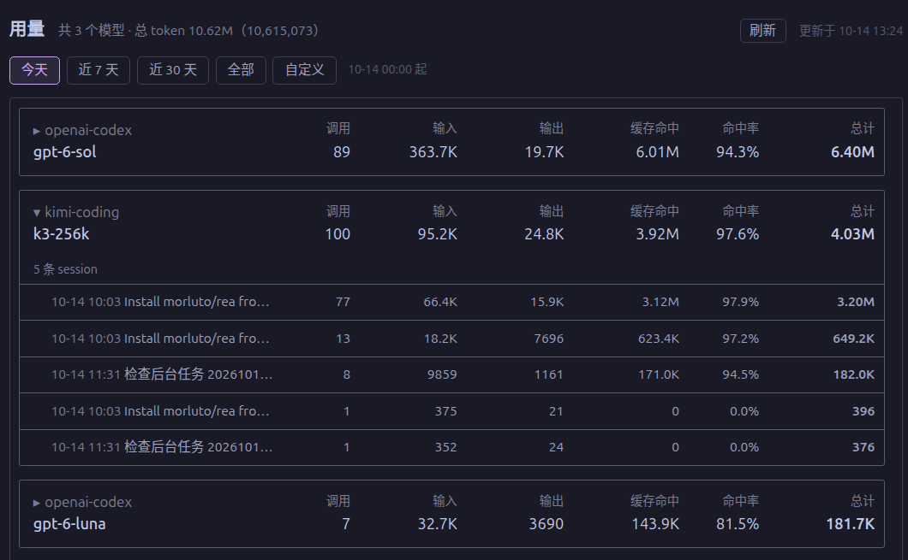

# hermes-token-usage

[Hermes Agent](https://github.com/NousResearch/hermes-agent) 桌面端插件：侧边栏新增「用量」页，按 provider/model 统计指定时间范围内的 token 用量。


## 界面预览



## 功能

- 侧边栏「消息平台」下方新增 **用量** 入口
- 按 `provider/model` 分组展示：调用次数、输入、输出、缓存命中、命中率、总计 token
- 每个块两行布局：第一行灰色 provider + 列标签，第二行 model + 数值，列严格对齐
- 点击块展开该模型下每条 session 的明细（列与父级对齐）
- 时间范围：今天 / 近 7 天 / 近 30 天 / 全部 / 自定义日期区间
- 每 30 秒自动刷新，也可手动刷新
- 只读查询 `~/.hermes/state.db` 的 `session_model_usage` 表（WAL 模式快照读，不阻塞主进程写入）

## 目录结构

```
agent/                  # agent 侧（后端 API），安装到 ~/.hermes/plugins/token-usage/
├── plugin.yaml
├── __init__.py
└── dashboard/
    ├── manifest.json   # 挂载 FastAPI 路由
    └── plugin_api.py   # GET /api/plugins/token-usage/usage?start=&end=
desktop/                # 桌面端（前端页面），安装到 ~/.hermes/desktop-plugins/token-usage/
└── plugin.js           # 侧边栏导航 + 用量页 React 组件
```

## 安装

```bash
git clone https://github.com/hasdsde/hermes-token-usage.git
cd hermes-token-usage

# 后端（agent 插件）
mkdir -p ~/.hermes/plugins/token-usage
cp -r agent/* ~/.hermes/plugins/token-usage/

# 前端（桌面插件）
mkdir -p ~/.hermes/desktop-plugins/token-usage
cp desktop/plugin.js ~/.hermes/desktop-plugins/token-usage/
```

在 `~/.hermes/config.yaml` 的 `plugins.enabled` 中加入 `token-usage`：

```yaml
plugins:
  enabled:
    - token-usage
```

重启 gateway（后端路由生效）；桌面端 plugin.js 保存即热重载，无需重启。

## 卸载

```bash
rm -rf ~/.hermes/plugins/token-usage ~/.hermes/desktop-plugins/token-usage
```

并从 `config.yaml` 的 `plugins.enabled` 中移除 `token-usage`。

## 说明

- 命中率 = 缓存命中 ÷ (输入 + 缓存命中)
- 时间过滤用重叠区间：usage 行的 `[first_seen, last_seen]` 与查询区间相交即计入
- 数值缩写显示（K/M/B），悬停查看完整数字
